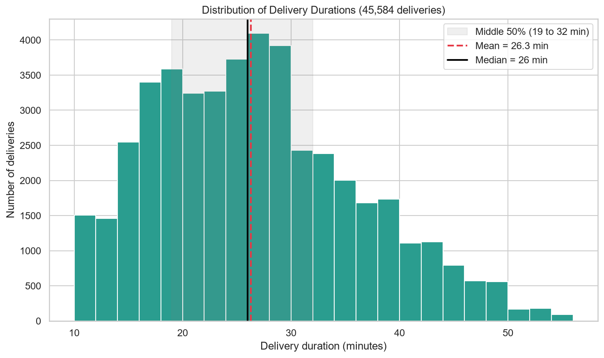
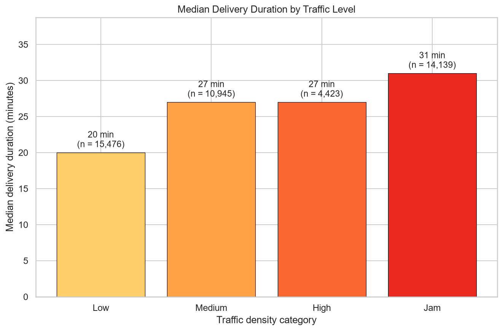
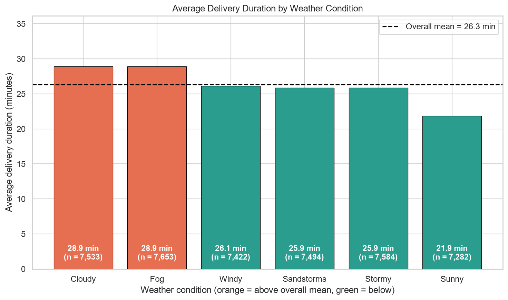
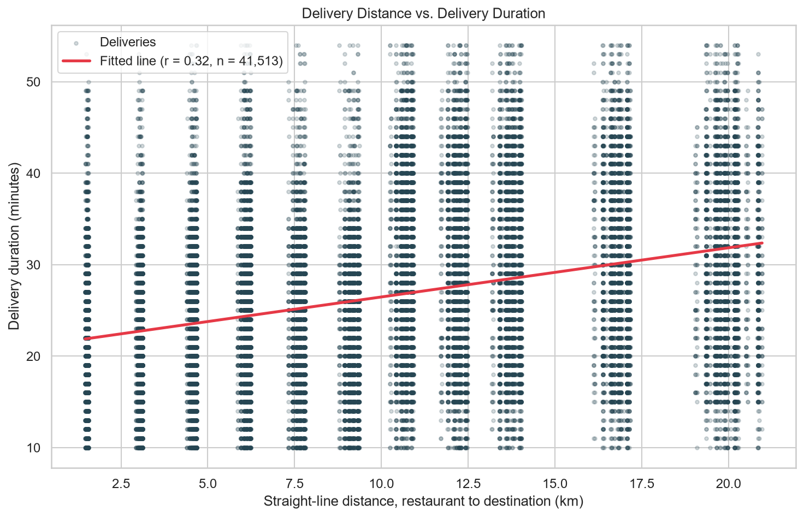
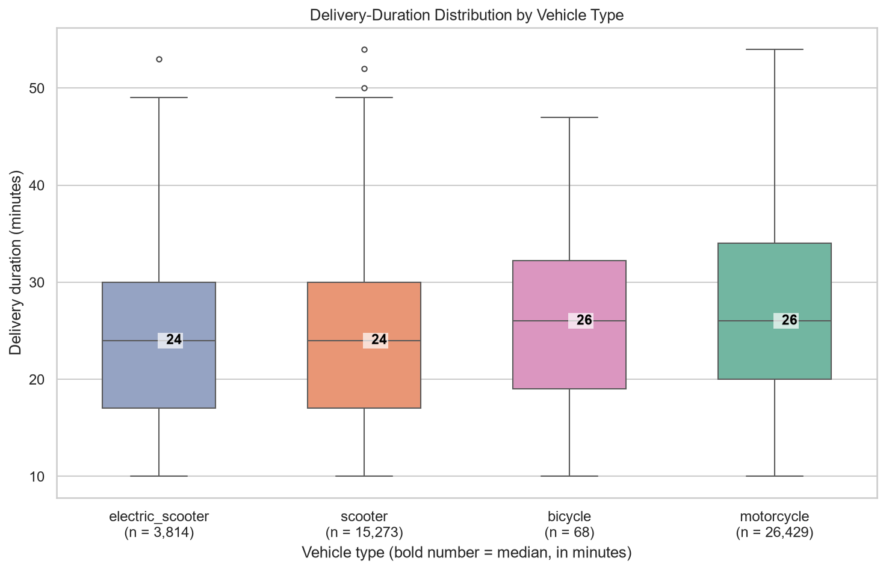

# Food Delivery Data Analysis

Kagnus Data Analytics Internship project. This repository holds all four weekly assignments. Weeks 1, 2 and 3 are complete.

## Project objective
Act as a junior data analyst for a food-delivery operations team: understand the delivery dataset, check its quality, clean it with every decision justified, and explore how delivery duration varies with fields such as traffic, weather, distance, vehicle type and partner characteristics.

## Dataset source
Food delivery dataset supplied by Kagnus (link and access instructions in `data/raw/README.md`). The raw file is not redistributed because its licence is not stated.

## Tools and libraries
Python, Jupyter Notebook, pandas, NumPy, matplotlib, seaborn.

## Folder structure
```
food-delivery-data-analysis/
├── data/
│   ├── raw/
│   │   └── README.md                  # source and access instructions (raw CSV not uploaded)
│   └── processed/
│       └── cleaned_food_delivery.csv  # cleaned dataset (Week 1 output)
├── notebooks/
│   ├── 01_data_understanding_and_cleaning.ipynb
│   ├── 02_exploratory_data_analysis.ipynb
│   └── 03_visualization.ipynb
├── visualizations/
│   ├── initial_distance_vs_duration.png      # Week 2 initial scatter plot
│   ├── 01_delivery_duration_distribution.png
│   ├── 02_traffic_comparison.png
│   ├── 03_weather_comparison.png
│   ├── 04_distance_vs_duration.png
│   └── 05_vehicle_comparison.png
├── docs/
│   └── cleaning_log.csv               # issue, affected column, affected rows, action, reason
├── README.md
└── requirements.txt
```

## How to run
1. Download the dataset (see `data/raw/README.md`) and save it as `data/raw/Food delivery Dataset.csv`.
2. Install the packages: `pip install -r requirements.txt`
3. Start Jupyter and run `notebooks/01_data_understanding_and_cleaning.ipynb` from top to bottom. This creates the cleaned CSV and the cleaning log.
4. Run `notebooks/02_exploratory_data_analysis.ipynb` from top to bottom. It reads the cleaned CSV and creates the scatter plot in `visualizations/`.
5. Run `notebooks/03_visualization.ipynb` from top to bottom. It reads the cleaned CSV and exports the five final charts to `visualizations/`.

---

## Week 1: Dataset Understanding and Cleaning
Notebook: `notebooks/01_data_understanding_and_cleaning.ipynb` · Cleaning log: `docs/cleaning_log.csv`

**Results**
- Raw dataset: 45,584 rows x 20 columns. Cleaned dataset: 45,584 rows x 21 columns (the extra column is `has_valid_coordinates`).
- No rows were removed: the row count is identical before and after, so no exact duplicates needed removal.
- 4,071 rows (8.9%) have coordinates outside India's range. They were kept and flagged with `has_valid_coordinates`, not deleted.
- 53 ratings fell outside the assumed 0 to 5 scale and were set to missing (non-null ratings fell from 43,676 in the raw data to 43,623 after cleaning).
- Missing values were kept as missing, not imputed. The most affected column after cleaning is `Delivery_person_Ratings` (1,961 missing, 4.3%).
- Category labels, spelling and data types (for example `Order_Date`) were standardised, and each change is recorded in the cleaning log.

**Decisions and assumptions**
- No data dictionary was provided, so column meanings are inferred from names.
- Assumed: ratings use a 0 to 5 scale; plausible partner age is 18 to 65; valid coordinates lie in latitude 6 to 38 and longitude 68 to 98.
- Outliers and same-ID rows with different content were retained and documented.
- Time columns have no dates, so time differences must allow for midnight.

---

## Week 2: Exploratory Data Analysis
Notebook: `notebooks/02_exploratory_data_analysis.ipynb` · Chart: `visualizations/initial_distance_vs_duration.png`

**Analyses performed**
- Delivery-duration baseline (count, mean, median, minimum, maximum, quartiles, standard deviation, skewness)
- Comparisons by traffic, weather and vehicle type (delivery count, mean and median duration, mean distance)
- Distance vs. duration: correlation coefficients, distance-band table and scatter plot
- Additional fields: multiple deliveries, ratings and partner age
- Nine written observations, each with the question, metric, result, comparison, group size and a cautious interpretation

**Main observations**
- **Baseline:** median 26 min, mean 26.3 min, standard deviation 9.4 min across 45,584 deliveries (range 10 to 54 min). The distribution is close to symmetric (skewness 0.49), and only 270 deliveries (0.6%) are statistical outliers.
- **Traffic:** median 31 min in Jam (n = 14,139) vs 20 min in Low traffic (n = 15,476), a gap of 11 minutes. Jam deliveries also travel farther on average (12.0 vs 8.1 km), so distance is a possible confounder. High-traffic deliveries were the shortest on average (4.4 km) yet had a median of 27 min.
- **Weather:** median 28 min in Cloudy and Fog vs 20 min in Sunny (n = 7,282), a gap of 8 minutes. Average distance was similar across weather groups (9.6 to 9.8 km), so distance does not explain this gap.
- **Distance:** Pearson r = 0.321 (moderate, positive), so distance accounts for about 10.3% of the variation in duration (n = 41,513). Median duration rose from 21 min in the shortest-distance quarter to 29 min in the longest.
- **Vehicle type:** differences are small (medians of 24 to 26 min). Only 68 bicycle deliveries exist, so that group is too small to compare reliably.
- **Multiple deliveries:** median duration rises from 22 min (value 0) to 48 min (value 3), the largest gap of any factor examined. The groups with values 2 and 3 are small (about 5% of deliveries together).
- **Ratings and partner age:** both are moderately associated with duration (Spearman rho = -0.294 and 0.312). The lowest-rated quarter was about 9 minutes slower, and partners aged 30 and over about 7 minutes slower.

**Limitations and unavailable fields**
- All results are associations, not proof of cause. Traffic, distance, weather and other factors overlap.
- Distance is straight-line, not road distance, and is only available for rows with valid coordinates (8.9% excluded).
- Ratings and `multiple_deliveries` have no documented meaning, so results using them are tentative.
- **Partner experience could not be analysed**, because the dataset has no direct experience field. Age is not a measure of experience.
- Missing values are excluded from each comparison only, and the number excluded is shown under each table.

---

## Week 3: Visualization and Interpretation
Notebook: `notebooks/03_visualization.ipynb`

Five charts were created from the cleaned dataset, exported as PNG files, and each is followed by a 2 to 3 sentence interpretation (what it shows, what it may indicate, and one limitation). Bar charts start at zero, every axis has a label and unit, and the values plotted are shown in a table above each chart in the notebook.

| # | Chart | Purpose | Main pattern observed |
|---|---|---|---|
| 1 | [Delivery-duration distribution (histogram)](visualizations/01_delivery_duration_distribution.png) | Show what a typical delivery looks like and whether extreme values exist | Median 26 min, mean 26.3 min; the middle 50% took 19 to 32 min; close to symmetric (skewness 0.49); 270 deliveries (0.6%) are statistical outliers |
| 2 | [Median duration by traffic level (bar chart)](visualizations/02_traffic_comparison.png) | Compare delivery time across traffic categories, with group sizes | Medians of 20 min (Low), 27 (Medium), 27 (High) and 31 (Jam); Jam deliveries also travel farther on average |
| 3 | [Average duration by weather (bar chart)](visualizations/03_weather_comparison.png) | Compare average delivery time across weather conditions | Cloudy and Fog highest (28.9 min each), Sunny lowest (21.9 min), against an overall mean of 26.3 min |
| 4 | [Distance vs. duration (scatter plot)](visualizations/04_distance_vs_duration.png) | Show the direction and strength of the distance relationship and unusual points | Moderate positive relationship (r = 0.321, n = 41,513); distance accounts for about 10% of the variation |
| 5 | [Duration by vehicle type (box plot)](visualizations/05_vehicle_comparison.png) | Compare whole distributions (median, spread, outliers) across vehicle types | Medians of 24 to 26 min; wide spread in every group; only 68 bicycle deliveries, so that group is unreliable |







**Limitations**
- Every chart shows an association, not a cause. Traffic, distance, weather and vehicle type overlap, and none of the charts control for the others.
- Distance is straight-line and available only for rows with valid coordinates (8.9% excluded).
- Missing traffic and weather values (601 and 616 deliveries) are excluded from their charts.
- Group sizes are uneven (for example 68 bicycle deliveries against 26,429 motorcycle deliveries), which the box plot labels show.

---

## Next steps
- Week 4: findings, operational recommendations and the final report
